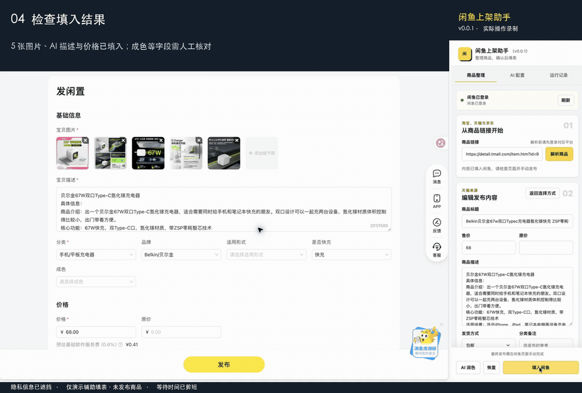
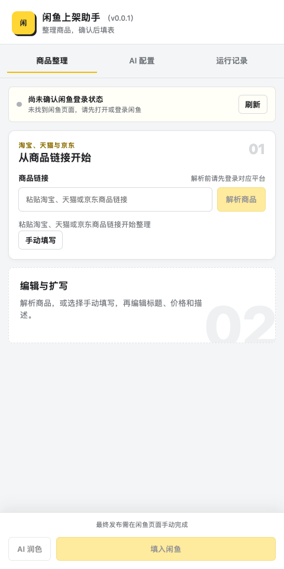
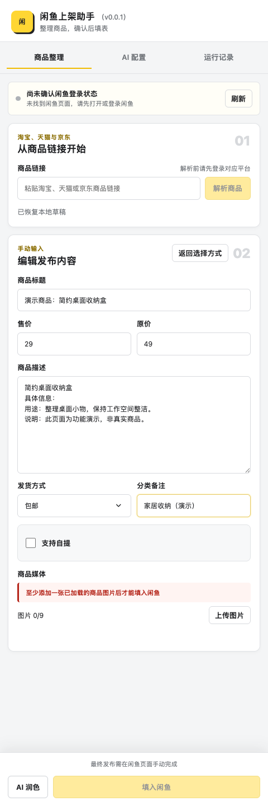
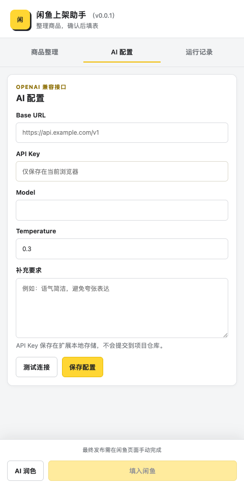

# 闲鱼上架助手

把商品资料整理成可编辑的闲鱼发布草稿，在 Chrome 侧边栏完成信息核对、文案整理和图片准备，减少重复复制粘贴。

这是一个独立开发的辅助工具，与淘宝、天猫、京东和闲鱼官方无隶属或合作关系。它只帮助整理与填表，**不会点击闲鱼最终的“发布”按钮**。

[下载与版本记录](https://github.com/yanquankun/xianyu-assistant-releases/releases) · [反馈问题](https://github.com/yanquankun/xianyu-assistant-releases/issues)

> 本仓库仅提供使用文档、演示视频、截图和发布附件，不提供开发源码。安装包与版本说明请以 [Releases](https://github.com/yanquankun/xianyu-assistant-releases/releases) 为准。

## 使用前必读：合规与账号风险

**安装和使用前，请完整阅读 [合规使用与法律风险说明](LEGAL.md)。在该说明已充分提示、你有合理机会阅读和理解的前提下，开始或继续使用即视为同意该说明，并知悉、自愿接受其中披露的各项风险，在法律允许范围内承担依法应由你承担的后果；不同意请停止使用并移除插件。**

- 不同平台、扫码或第三方登录渠道可能出现会话失效、账号误用及额外验证；辅助操作可能触发平台风控、功能限制、下架或账号冻结、封禁，插件不保证账号安全或免受处罚。
- 本地草稿、媒体和 AI 配置不会随平台账号切换自动隔离；操作前必须核对当前登录账号与目标页面。
- 用户应自行核实平台规则、素材授权、交易内容和第三方 AI 服务条款，不得绕过访问控制或实施违法、侵权及平台禁止的活动。
- **风险接受不等于开发者免责；依法不得免除的责任及用户法定权利不受影响。**

## 为什么做这个插件

整理闲置商品时，常常需要在商品详情页、文案工具与闲鱼发布页之间切换，反复复制标题、核对价格、整理描述和准备图片。本工具把这些准备工作集中到浏览器侧边栏，让用户先整理、再检查、最后自行发布。

适合需要参考原商品信息整理个人闲置物品的用户。请只处理自己有权使用的商品资料和图片，不要将原商品信息直接当作二手物品的实际成色、配置或售后承诺。

## 能做什么

- **链接解析**：支持淘宝、天猫、京东商品链接及常见分享文案，提取可获取的标题、价格、描述和图片。
- **手动草稿**：没有来源链接时，也可以手动填写商品信息。
- **编辑与图片管理**：修改标题、售价、原价、描述和发货方式，上传本地图片，预览并删除不需要的图片。
- **可选 AI 润色**：连接自己配置的 OpenAI 兼容接口，辅助整理描述；可停止生成并恢复原文。
- **辅助填表**：把确认后的信息和图片填入闲鱼网页；部分字段失败时提供反馈。
- **本地保存**：在当前浏览器保存草稿、AI 配置和运行记录。

当前不支持新增视频或自动上传视频，不支持无人值守批量发布，也不代替用户核对商品真实性。

## 演示视频

**下面是视频实录**：使用天猫商品链接，完成「解析商品 → AI 润色 → 填入闲鱼 → 核对结果」。录制使用已安装的插件和已配置的 AI 服务，等待时间已剪短。

上方为完整流程的动图预览。点击预览图，或 [下载清晰版 MP4（47 秒，约 1 MB）](https://github.com/yanquankun/xianyu-assistant-releases/raw/refs/heads/main/media/demo-v0.0.1.mp4)，可查看原分辨率视频；也可 [查看填入结果截图](media/demo-preview.png)。

实录中已将 **5 张图片、AI 描述和价格**填入闲鱼，未点击最终「发布」。成色、规格、价格、运费及素材授权仍需用户核对；视频中的价格只是来源页面的抓取结果，不代表所展示规格的成交价或销售承诺。AI 生成的描述也需要人工检查。

公开画面已遮挡账号、头像、收货信息、浏览器私人区域和原有草稿；未展示 AI 配置或密钥，未录制麦克风与系统声音。

## 界面预览

以下为插件实际界面截图，使用全新隔离浏览器和虚构演示信息，没有真实账号、商品订单或 API Key；不是实站交易成功证明。

### 选择整理方式

### 编辑发布草稿

### 配置可选 AI 服务

## 安装

需要桌面版 **Chrome 116 或更高版本**。无需安装 Node.js、pnpm 或下载源码。

1. 打开本仓库的 [Releases](https://github.com/yanquankun/xianyu-assistant-releases/releases)，选择需要的版本。
2. 在 **Assets** 下载 `xianyu-assistant-<版本号>-chrome.zip`。不要下载 GitHub 自动生成的 `Source code (zip)` 或 `Source code (tar.gz)`，它们只是本说明仓库的文件。
3. 将 ZIP 解压到一个固定目录，确认其中包含 `manifest.json`。使用期间不要删除或移动该目录。
4. 在 Chrome 地址栏打开 `chrome://extensions`，开启右上角“开发者模式”。
5. 点击“加载已解压的扩展程序”，选择包含 `manifest.json` 的目录。
6. 在浏览器工具栏的扩展菜单中找到“闲鱼上架助手”，可将其固定到工具栏；点击图标打开侧边栏。

此安装方式用于自行加载可信扩展，需要手动更新。受组织管理的浏览器可能禁止开发者模式，请遵循所在组织的管理要求。

Release 同时附带 CRX 文件，但普通 Windows/macOS Chrome 限制商店外 CRX 安装，不能保证拖入浏览器即可安装；优先使用上面的 ZIP 步骤。详见 [Chrome 官方分发说明](https://developer.chrome.com/docs/extensions/how-to/distribute)。

## 使用步骤

1. 在浏览器中自行登录需要访问的商品平台和闲鱼。
2. 打开插件，在“商品整理”中粘贴商品链接或分享文案并解析，也可以选择“手动填写”。
3. 核对标题和价格，按自己物品的实际情况填写成色、配件和交易说明，检查发货方式与邮费。
4. 上传或保留需要的商品图片，删除无关图片。至少需要一张已加载的图片才能填入闲鱼；媒体总数最多 9 个。
5. 如需 AI 辅助，先打开“AI 配置”，填写服务商提供的 Base URL、API Key 和模型名称，保存并测试，然后返回编辑区执行润色。无需 AI 时可跳过。
6. 确认内容后点击“填入闲鱼”，等待填表结果，按提示处理失败或缺失字段。
7. **在闲鱼页面再次检查标题、价格、描述、图片、分类和运费，由你手动点击最终发布按钮。**

遇到未登录提示时，完成对应站点登录后返回重新解析。验证码、访问频控及平台限制需要用户自行按平台要求处理，插件不会绕过。

## 更新与卸载

- 更新：下载新版 ZIP，关闭正在进行的整理或填表任务，解压后用新版文件替换原固定目录的内容；在 `chrome://extensions` 点击扩展的重新加载按钮，核对版本，并刷新相关商品和闲鱼页面。
- 建议沿用同一个目录，更新前保留尚未发布的重要文字和图片；不要先卸载再安装，以免丢失本地数据。
- 卸载：在扩展管理页点击“移除”。扩展本地存储会随卸载清除。
- 本项目目前不通过 Chrome 应用商店分发，GitHub 下载版本不会自动更新。

## 隐私与数据流向

- 草稿、媒体、配置和运行记录保存在当前浏览器的扩展存储中。API Key 也保存在本地，请不要共享浏览器配置目录或在公共设备保存密钥。
- 解析与填表需要访问对应平台页面和商品图片资源，并操作闲鱼表单；扩展不读取浏览器 Cookie，不代替用户登录。
- 使用 AI 时，会向你配置的服务端发送润色所需的商品标题、文本、价格、发货信息和提示词，并使用所填 API Key 鉴权。当前 AI 润色不发送商品链接、图片文件、图片 URL 或视频。
- AI 服务的费用、数据留存和隐私条款由所选服务商决定；请确认后再使用，避免在商品描述中输入联系方式等不必要的个人信息。
- 反馈问题时请先遮盖账号、头像、联系方式、地址、订单、API Key 和敏感链接。**不要把完整浏览器日志或配置直接提交到公开 Issue。**

## 常见问题与边界

**为什么解析或填表失败？** 平台页面结构、登录状态、验证码和频控会影响结果。请先阅读插件提示，完成登录或手动补充字段；如持续失败，可提供脱敏后的错误信息。

**AI 会看图片判断商品吗？** 当前润色只使用已提供的文本和相关字段，不分析图片。生成内容可能不准确，未知参数、成色与交易承诺需要你自行核对。

**能自动发布或保证平台接受吗？** 不能。插件不执行最终发布，不保证所有页面或商品类型都能解析、填表成功，也不保证平台审核结果。

**是否开源、可以再分发或商业使用？** 本仓库公开不表示插件开源。插件为专有软件，保留所有权利；使用及再分发等授权请联系维护者确认。第三方组件的权利归各自权利人所有。

## 反馈

请在 [Issues](https://github.com/yanquankun/xianyu-assistant-releases/issues) 中提供插件版本、Chrome 版本、操作系统、复现步骤、预期与实际结果，必要时附上已脱敏截图。请勿公开提交真实订单、账户凭证或私人商品信息。
